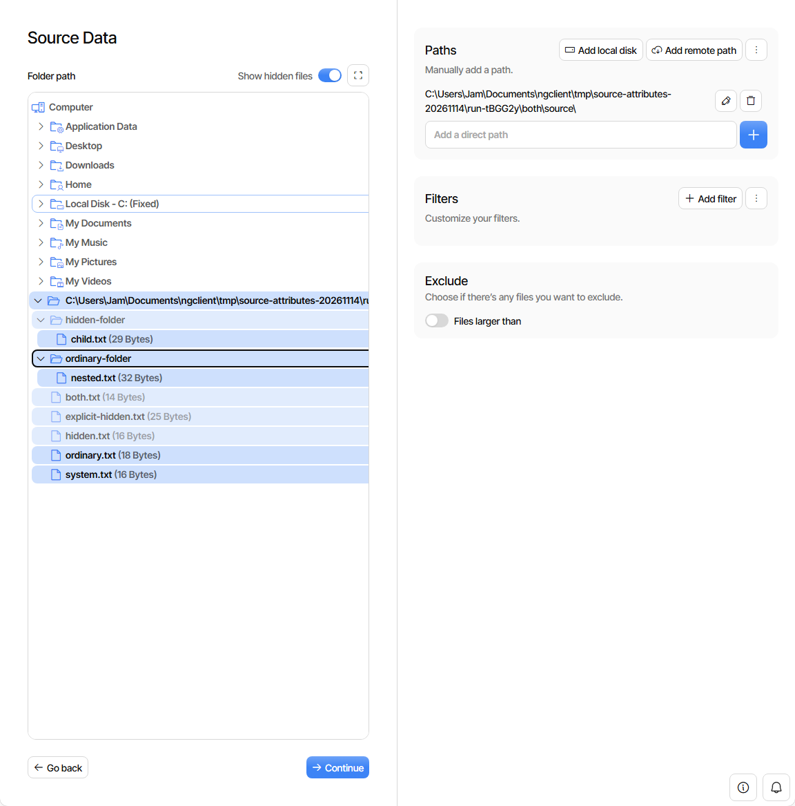
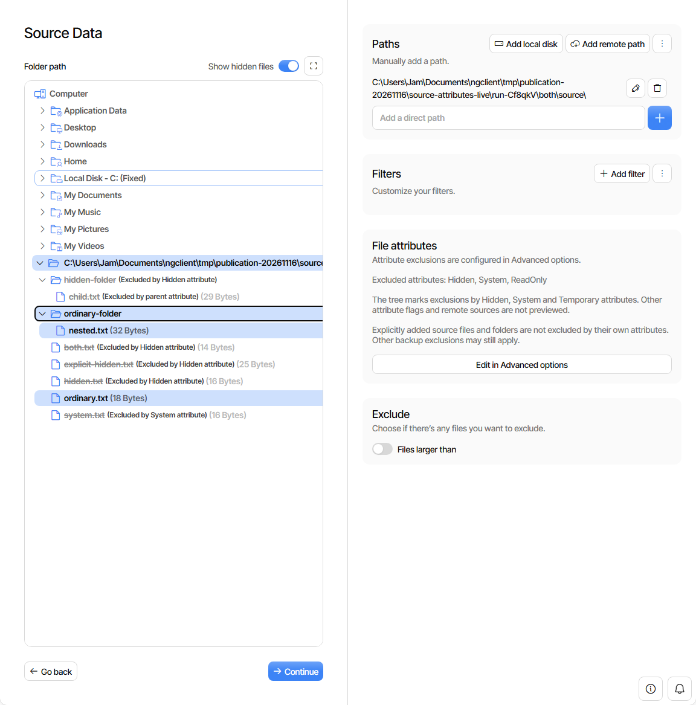

Fixes #637

## Summary

Keep attribute configuration in Advanced options, and add its current value and an editing shortcut to Source Data. Do not restore the separate Hidden/System checkboxes.

Use the existing filesystem listing's `hidden`, `systemFile` and `temporary` fields to mark attribute-excluded local entries, including an accessible exclusion reason. Reflect setting changes in the tree without rewriting the saved flags or path filters. Preserve other flags such as ReadOnly.

Match the backup engine's explicit-source exception: a directly selected source is not excluded by its own attributes. Mark descendants of an excluded folder, and allow an excluded entry to be explicitly selected as a source. Keep path-filter selection separate from attribute feedback. Other attribute flags and remote sources are explicitly not previewed; this is not a preview of every possible backup exclusion.

No server API, generated client or dependency changes are required. The prerequisite #727 is merged into the main used by this branch. This PR is based directly on main and requires no other ngclient PR.

## Screenshots

Production UI with isolated Windows servers and the same seven-file fixture shape. Temporary directory names differ. Hidden and System are excluded, with an unrelated ReadOnly flag retained.

| Before: main `8f401edd337b`                                                                                                                                                                   | After: `ed6b24f2bac9`                                                                                                                                                                                 |
| --------------------------------------------------------------------------------------------------------------------------------------------------------------------------------------------- | ----------------------------------------------------------------------------------------------------------------------------------------------------------------------------------------------------- |
|  |  |

Images are stored outside the code branch at immutable commit URLs.

The before image is from the initial main baseline; the after image is from the current rebased production build.

## Testing

- Node.js 26 / Bun 1.4.4, on the rebased branch.
- `VITEST_MAX_WORKERS=1 bun run test:ci`: **2381 passed** (full unit suite).
- `tsc --noEmit` for app and spec configurations: passed.
- `bun run build:prod`: passed.

- `node node_modules/@playwright/test/cli.js test e2e/attribute-exclusions.spec.ts`: **4 passed**, against the production build with mocked APIs. E2E type checking also passed.
- Local browser checks used an available port because Windows reserves port 3000; the repository configuration was restored unchanged.
- Isolated Windows Duplicati 2.4.1.101 Canary: six existing attribute cases plus two new-option cases (mouse and keyboard) passed. Tree feedback matched the backed-up contents; settings survived saving/reopening with ReadOnly retained. Test jobs were removed and servers stopped.

The existing jsdom stylesheet parsing messages were present in the passing unit run.

Based independently on main [ae54d73bf1e5e98fb65dd8060c006f1defc90d01](https://github.com/duplicati/ngclient/commit/ae54d73bf1e5e98fb65dd8060c006f1defc90d01); no predecessor PR is required.
Verified commit: [ed6b24f2bac9b9fe2cce3b9a1ae926591ca9385d](https://github.com/JamBalaya56562/ngclient/commit/ed6b24f2bac9b9fe2cce3b9a1ae926591ca9385d).

🤖 Generated with [Claude Code](https://claude.com/claude-code)
