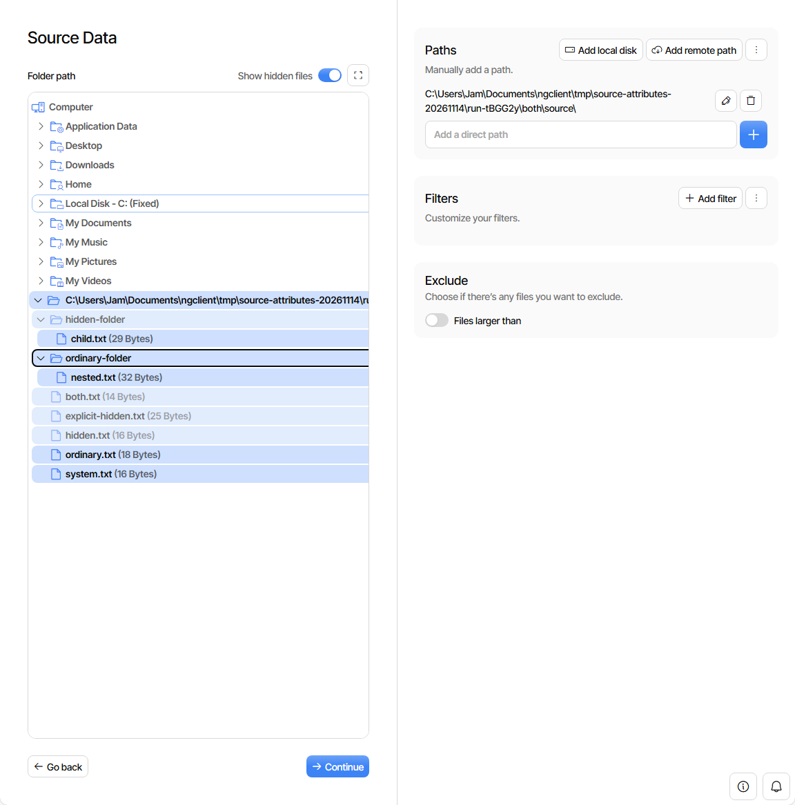
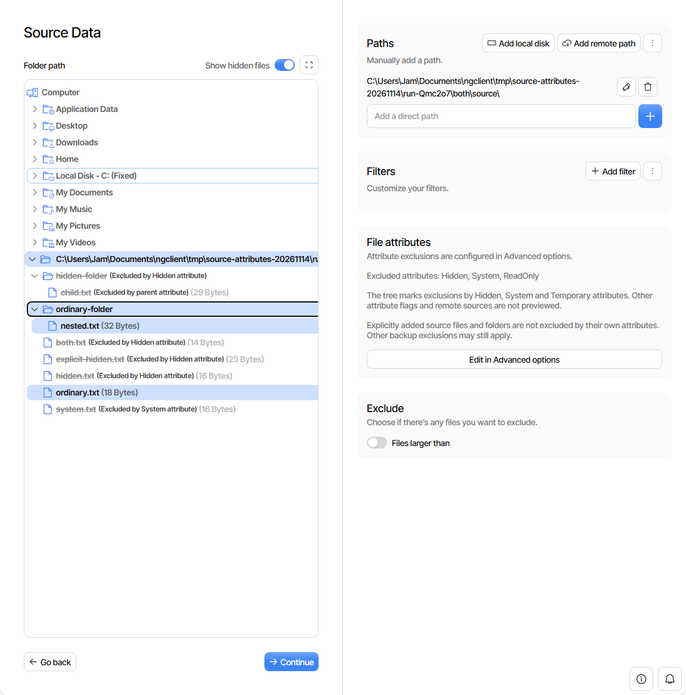

<!-- Publication gate: #727 is still open. Rebase after it merges and recheck adding a previously absent attribute option by mouse and keyboard before publishing. -->

Fixes #637

## Summary

Keep attribute configuration in Advanced options, and add its current value and an editing shortcut to Source Data. Do not restore the separate Hidden/System checkboxes.

Use the existing filesystem listing's `hidden`, `systemFile` and `temporary` fields to mark attribute-excluded local entries, including an accessible exclusion reason. Reflect setting changes in the tree without rewriting the saved flags or path filters. Preserve other flags such as ReadOnly.

Match the backup engine's explicit-source exception: a directly selected source is not excluded by its own attributes. Mark descendants of an excluded folder, and allow an excluded entry to be explicitly selected as a source. Keep path-filter selection separate from attribute feedback. Other attribute flags and remote sources are explicitly not previewed; this is not a preview of every possible backup exclusion.

No server API, generated client or dependency changes are required. The code branch is based directly on main, but publication is waiting for #727: its fix is needed to add a previously absent advanced option. A real-server browser probe confirmed that Add advanced option is disabled without it.

## Screenshots

Production UI with isolated Windows servers and the same seven-file fixture shape. Temporary directory names differ. Hidden and System are excluded, with an unrelated ReadOnly flag retained.

| Before: main `8f401edd337b`                                                                                                                                                                   | After: `68c088a6e6bb`                                                                                                                                                                                 |
| --------------------------------------------------------------------------------------------------------------------------------------------------------------------------------------------- | ----------------------------------------------------------------------------------------------------------------------------------------------------------------------------------------------------- |
|  |  |

Images are stored outside the code branch at immutable commit URLs.

## Testing

- Regression tests before implementation: **3 failed / 7 passed**. Final related source-data/file-tree suite: **333 passed / 22 files**.
- App/spec `tsc --noEmit`, Prettier on the eight changed files, and `bun run build:prod`: passed.
- Production-build `e2e/attribute-exclusions.spec.ts`: **2 passed** (mocked API regressions).
- Real Windows Duplicati **2.4.1.101 Canary**: **6 cases passed**, comparing the tree with the backed-up file and descendant listings: no attribute setting, Hidden, System, both, an explicitly selected Hidden file, and a Hidden source folder. Backup reports contained no errors or warnings.
- Changed System in the existing editor and returned to Source Data without reloading: feedback updated. Saved/reopened the setting while retaining ReadOnly and all source paths.
- Test-created jobs removed, isolated servers stopped, temporary local Vitest worker-start timeout adjustment restored.

The unit environment's existing stylesheet parsing messages and Playwright's NO_COLOR/FORCE_COLOR warning remain. Linux/macOS, remote providers and actual Temporary-attribute files were not exercised by this live run.

Verified source: [68c088a6e6bb2c1d2e07a03a338ead45b348950e](https://github.com/JamBalaya56562/ngclient/commit/68c088a6e6bb2c1d2e07a03a338ead45b348950e), parent `8f401edd337bf53a963fc4e80a47d3db4d52fc3d`.

🤖 Generated with [Claude Code](https://claude.com/claude-code)
